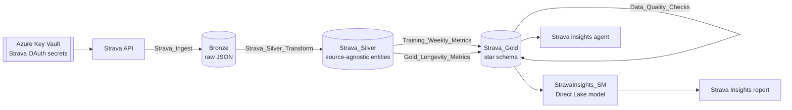

# Strava Insights

Personal training & longevity analytics on **Microsoft Fabric**. Your Strava history is refreshed daily into a Power
BI report (longevity habits, cycling, running, single-activity analysis) and a Fabric data agent, all in
your own Fabric workspace, with your Strava credentials kept only in your Azure Key Vault.

Open source (MIT) — install it into your own Fabric workspace with your own Strava account in about 15 minutes.
Nothing in this repository belongs to a specific person: every workspace, lakehouse, Key Vault and item reference is a
placeholder that the installer replaces with yours.

## Set it up with your own account

You need a Microsoft Fabric capacity (a free [Fabric trial](https://learn.microsoft.com/fabric/fundamentals/fabric-trial)
works), an Azure subscription (one Key Vault, cents per month), a Strava account, and Python 3.10+ with the
[Azure CLI](https://aka.ms/azure-cli) and git. Full guide with troubleshooting: **[docs/setup.md](docs/setup.md)**.

1. **Create your own Strava API app** at <https://www.strava.com/settings/api> — *Website* `http://localhost`,
   *Authorization Callback Domain* `localhost`. Keep the Client ID and Client Secret at hand.
2. **Get the code and sign in to Azure** with the account that can use your Fabric capacity:

   ```powershell
   git clone https://github.com/vuhrova/StravaInsights.git
   cd StravaInsights
   az login                      # add --tenant <your-tenant> if you have several
   ```

3. **Run the installer** (pick a globally unique Key Vault name):

   ```powershell
   python tools/install.py --workspace "Strava Insights" --key-vault <unique-vault-name> --resource-group rg-strava-insights --location westeurope
   ```

   It creates the workspace and lakehouses, creates the Key Vault, asks for your Strava Client ID / Secret and opens
   Strava's consent page in your browser, deploys the notebooks and pipeline with a daily schedule, loads your history
   and deploys the semantic model, report and data agent. At the end it prints the link to your report.

4. **Upgrade later** with `git pull` and `python tools/install.py` (no arguments needed; your data stays).

Your settings (workspace id, Key Vault, schedule — never secrets) are saved in `stravainsights.local.json`, which is
git-ignored, so they never end up in a commit or a fork.



## Report pages

| Page | What it answers |
|---|---|
| **Longevity** | A five-step story of the period (movement → consistency → aerobic base → fitness → focus next), then active minutes and steps per day, sessions and active days per week, WHO guideline minutes (150–300 / week), Zone 2 hours, running and cycling VO2max, FTP, W/kg, max HR, strength sessions; training mix and trends |
| **Cycling** | Overview (rides, km, hours, elevation, speed, power) and performance (FTP, W/kg, FTP vs previous period, best 5 min, CTL and form at period end) → volume & intensity → monthly FTP, power curve vs previous period, power vs HR, fitness/fatigue/form → recent rides |
| **Running** | Same layout as Cycling: volume, pace, running VO2max (VDOT), best 5K/10K, cadence → volume & intensity → best efforts vs previous period, VO2max trend, pace vs HR, fitness/fatigue/form → recent runs |
| **Activity Analysis** | One session: KPIs, a plain-language summary, speed & HR per section, HR zones, elevation, splits |

All pages share a synced single-select **Period** slicer (Last 4 weeks, 3 / 6 / 12 months, This year, Last 2
years; default: last 6 months) and end with a data status line (*Data as of … · Synced … · 24/24 data checks passed*).
See [docs/reading-the-dashboard.md](docs/reading-the-dashboard.md) for how to read the report.

## Reliability and data quality

* `Refresh_Orchestration` runs daily (one run at a time): ingest → Silver → Gold → longevity metrics → workout plan →
  **data quality checks** → semantic model refresh. The Strava ingestion respects Strava's rate limits, resumes where
  it stopped and retries transient failures.
* `Data_Quality_Checks` reconciles Bronze → Silver → Gold (counts and distance), checks freshness, keys, dimension
  integrity, plausibility of speed / heart rate / power, the Period bridge, and that no token table exists. Results
  are in `DataQualityCheck`, `DataQualityHistory` and `DataStatus` (Gold). A failed error-severity check fails the run
  after the report is refreshed, so the failure is visible in the Monitor hub and in the report's status line.

## Repository layout

| Path | Content |
|---|---|
| `workspace/<Item>.<Type>/` | Fabric item definitions (notebooks, pipeline, semantic model, report, data agent) |
| `workspace/environment.json` | Placeholder IDs (`00000000-0000-4000-8000-…`, `your-key-vault`, `your-sql-endpoint`) that the definitions reference; `deploy` rewrites them to your workspace and `export` rewrites your real IDs back to them |
| `tools/install.py` | One-command install / upgrade into your own workspace |
| `tools/strava_auth.py` | Connect or reconnect Strava (browser consent, secrets into Key Vault) |
| `tools/fabric_sync.py` | Export / deploy / run / DAX-query helper (uses your `az login`, no stored credentials) |
| `docs/` | Setup guide, data model and metric definitions |

## Developing

Run `tools/install.py` once first; the other tools then target the workspace and Key Vault it recorded.

```powershell
az login                                                     # account with access to your Fabric workspace
python tools/fabric_sync.py export                           # pull current definitions from Fabric (your IDs -> placeholders)
python tools/fabric_sync.py deploy "workspace/Strava Insights.Report"
python tools/fabric_sync.py run Refresh_Orchestration --type DataPipeline
python tools/fabric_sync.py dax StravaInsights_SM "EVALUATE ROW(\"VO2max running\", [VO2max Running])"
```

`deploy` targets `FABRIC_WORKSPACE_ID`, else the workspace recorded by `tools/install.py` in
`stravainsights.local.json` (Key Vault: `STRAVA_KEY_VAULT_URL`, else the same file). `export` never writes your
workspace, lakehouse, SQL endpoint, item or Key Vault IDs into the repository; a new item gets a new placeholder in
`environment.json`. Deploy new items before the items that reference them (e.g. a new notebook before the pipeline).

## Contributing

Issues and pull requests are welcome — new data sources (Garmin, Apple Health, …), metrics, report pages or fixes.
Before you open a pull request, check that `git diff` contains no IDs of your own workspace and no
`stravainsights.local.json`; `export` and `.gitignore` take care of both.

## Privacy and secrets

Nothing in this repository can be used to access anyone's Strava data or Fabric workspace.

* Strava OAuth credentials are stored only in **your Azure Key Vault**: `strava-client-id`, `strava-client-secret`,
  `strava-refresh-token`, written by `tools/strava_auth.py`.
* Notebooks read them at run time with `notebookutils.credentials.getSecret` under the identity that runs the pipeline
  (needs *Key Vault Secrets Officer*, because Strava rotates refresh tokens). Access tokens are kept in memory only.
* `Data_Quality_Checks` fails the run if a plaintext token table ever appears in a lakehouse.
* The Azure CLI sign-in (`az login`) is used for every API call; no Azure or Fabric credentials are stored anywhere.
* Your activity data stays in your own Fabric workspace in your own Microsoft tenant.

## Metric definitions

See [docs/data-model.md](docs/data-model.md), [docs/longevity-metrics.md](docs/longevity-metrics.md) and
[docs/reading-the-dashboard.md](docs/reading-the-dashboard.md).

## License and disclaimer

[MIT](LICENSE). This is a community project, not affiliated with or endorsed by Strava or Microsoft. Use of the
Strava API is subject to the [Strava API Agreement](https://www.strava.com/legal/api); the report is for personal
fitness analytics, not medical advice.
