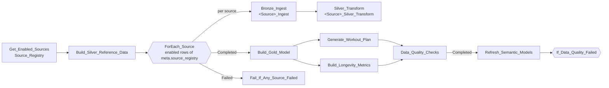
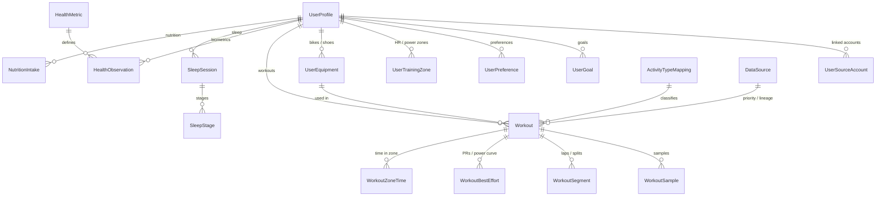
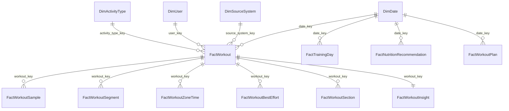

# StravaInsights data model (Bronze → Silver → Gold)

| Layer | Lakehouse | Naming | Shape | Built by |
|---|---|---|---|---|
| Bronze | `Bronze` (schemas enabled) | Schema = source system; table = source endpoint name | Raw JSON payload + lineage columns, append-only | `<Source>_Ingest` (e.g. `Strava_Ingest`) |
| Silver | `Strava_Silver` | `PascalCase` business entities | Normalized, source-agnostic entity model (no dim/fact) | `Silver_Reference_Data` + `<Source>_Silver_Transform` |
| Gold | `Strava_Gold` | `PascalCase`, `Dim*` / `Fact*` | Star schema for Power BI and the data agent | `Training_Weekly_Metrics`, `Strava_Workout_Generator` |

## How source systems are differentiated

| Layer | Mechanism |
|---|---|
| Bronze | One schema per source system (`strava`, later `garmin_connect`, `apple_health`, …) plus `source_system` on every row; control tables in schema `meta` |
| Silver | `source_system` + `source_*_id` on every table; each source replaces only its own slice (`replaceWhere source_system = '<source>'`); `DataSource` describes every source; `Workout.dedupe_group_id` / `is_primary_record` resolve the same workout recorded by several sources (lowest `workout_priority` wins) |
| Gold | `DimSourceSystem` (key `source_system_key`) related to `FactWorkout.source_system_key`; `FactTrainingDay` / `FactTrainingWeek` carry `source_systems` and `source_count` |
| Semantic models | `DimSourceSystem` table and `activities[source_system]` with a relationship, usable as slicer/filter in the report |

## Orchestration – pipeline `Refresh_Orchestration`

Runs daily at 05:00 (Central Europe time); can also be run on demand. Parameter `sources_filter` (comma separated) limits the run to specific sources.

Gold and the report are rebuilt even if one source fails (from the sources that succeeded); the run is still marked failed so the problem is visible.
`Data_Quality_Checks` writes `DataQualityCheck` / `DataQualityHistory` / `DataStatus`; the model is refreshed either way
and `If_Data_Quality_Failed` then fails the run when an error-severity check failed. Only one run executes at a time
(`concurrency: 1`); `Bronze_Ingest` retries twice, 5 minutes apart. The schedule is part of the pipeline definition
(`.schedules`) and is set by `tools/install.py`.

**Add a new data source (e.g. Garmin Connect)**
1. Create `Garmin_Ingest` (default lakehouse `Bronze`, writes raw data to schema `garmin_connect` and a row to `meta.ingestion_run_log`).
2. Create `Garmin_Silver_Transform` (writes its slice of the Silver tables with `source_system = 'garmin_connect'`; add its activity types to `ActivityTypeMapping` in `Silver_Reference_Data`).
3. Enable it: `UPDATE meta.source_registry SET is_enabled = true WHERE source_system = 'garmin_connect'` (rows for Garmin Connect and Apple Health are pre-registered).
4. The next pipeline run picks it up automatically – no pipeline change needed.

## Bronze – `Bronze`

| Schema | Table | Content | Load pattern |
|---|---|---|---|
| `meta` | `source_registry` | One row per source: Bronze schema, ingest/Silver notebooks, enabled flag, load order | Inserted once, edited by hand |
| `meta` | `ingestion_run_log` | One row per run and source: request usage, counts, remaining backfill | Append |
| `strava` | `athlete_activities` | `GET /athlete/activities` – activity summaries | Incremental (`after` watermark − 7 days) |
| `strava` | `activities` | `GET /activities/{id}` – laps, 1 km splits, best efforts, calories, RPE, gear | Not landed yet + last 2 days refreshed |
| `strava` | `activities_streams` | `GET /activities/{id}/streams` – per-second HR, power, cadence, speed, altitude, grade, temperature | Not landed yet |
| `strava` | `athlete` | `GET /athlete` – profile: weight, FTP, bikes, shoes | Snapshot each run |
| `strava` | `athlete_zones` | `GET /athlete/zones` – HR and power zones (requires `profile:read_all`) | Snapshot each run |

Common raw columns: `source_system`, `source_entity`, `source_record_id`, `athlete_id`, `api_endpoint`, `http_status`,
`raw_payload` (unchanged JSON), `payload_hash`, `ingested_at`, `ingestion_date`, `batch_id`.

## Silver – `Strava_Silver`

Source-agnostic entity model. Strava is the first source; Apple Health, Garmin Connect, Oura, WHOOP, manual entry and the iOS app
write into the same tables.

| Rule | Detail |
|---|---|
| Keys | Deterministic hash keys (`*_id`) + lineage columns `source_system`, `source_*_id` |
| Units | SI units in column names: `_m`, `_s`, `_mps`, `_bpm`, `_w`, `_kj`, `_kcal`, `_kg`, `_c`, `_pct` |
| Time | `*_utc`, wall-clock `*_local`, and `local_date` (the user's day) |
| Multi-source | Each source replaces only its own slice (`replaceWhere source_system = '<source>'`) |
| Source extras | Fields without a canonical home go to `source_attributes_json` |
| Privacy | GPS coordinates are not stored |

| Area | Table | Grain | Content |
|---|---|---|---|
| Reference | `DataSource` | source system | Sources, data domains, `workout_priority` for cross-source dedupe, enabled flag, Bronze schema and notebooks (from `meta.source_registry`); built by `Silver_Reference_Data` |
| Reference | `ActivityTypeMapping` | source + source activity type | Strava / HealthKit / Garmin types → canonical `activity_type`, `activity_family`, flags |
| Reference | `HealthMetric` | metric code | Metric catalogue: unit, daily aggregation, direction |
| User | `UserProfile` | user | Profile, home location, measurement system, primary time zone |
| User | `UserSourceAccount` | user + source account | Linked accounts, scopes, sync window |
| User | `UserTrainingZone` | user + zone type + model + zone | HR / power zones (source-defined or derived) |
| User | `UserEquipment` | equipment item | Bikes / shoes, distance, usage |
| User | `UserGoal` *(contract)* | goal | Goal type, target metric/value/date, priority, status |
| User | `UserPreference` *(contract)* | user + key | Diet, training days, wake time, … |
| Training | `Workout` | workout per source record | Type, timing, duration, distance, elevation, speed, HR, power, energy, RPE, TSS / TRIMP / training load, flags, `dedupe_group_id` + `is_primary_record` |
| Training | `WorkoutSample` | workout + sample | Per-second HR, power, cadence, speed, altitude, grade, temperature |
| Training | `WorkoutSegment` | workout + segment | Laps and 1 km splits |
| Training | `WorkoutBestEffort` | workout + effort | Distance PRs and derived mean-maximal power (5 s – 60 min) |
| Training | `WorkoutZoneTime` | workout + zone | Seconds and % in each HR / power zone |
| Health | `HealthObservation` | user + metric + time + method | Long-format biometrics (weight, FTP, max HR, resting HR, HRV, VO2max, steps, …) |
| Sleep | `SleepSession` *(contract)* | sleep session | Stages, efficiency, HR, HRV, respiration, SpO2, score |
| Sleep | `SleepStage` *(contract)* | stage interval | Stage, start/end, duration |
| Nutrition | `NutritionIntake` *(contract)* | food/meal entry | Energy, macros, fiber, sodium, caffeine, alcohol, water |
| Operations | `DataQualityIssue` | source record + rule | Rejected / flagged records and failed API calls |

*(contract)* = created empty with a fixed schema so new sources can plug in.

### Bronze → Silver lineage

| Bronze | Silver |
|---|---|
| `strava.athlete_activities` | `Workout` |
| `strava.activities` | `Workout` (calories, RPE, device, gear), `WorkoutSegment`, `WorkoutBestEffort` (distance) |
| `strava.activities_streams` | `WorkoutSample` → `WorkoutZoneTime`, `WorkoutBestEffort` (power), training load |
| `strava.athlete` | `UserProfile`, `UserSourceAccount`, `UserEquipment`, `HealthObservation` (weight / FTP) |
| `strava.athlete_zones` | `UserTrainingZone` (derived zones are used when the source has none) |

## Gold – `Strava_Gold` (star schema)

| Table | Grain | Content |
|---|---|---|
| `DimDate` | day | Year, quarter, month, `month_year_label`, week start, ISO week, day name, weekend flag |
| `DimActivityType` | canonical activity type | Name, family, endurance / distance / indoor flags, primary intensity metric |
| `DimUser` | user | Name, sex, country, measurement system, time zone |
| `DimSourceSystem` | source system | Name, category, integration method, active flag, dedupe priority, Bronze schema |
| `FactWorkout` | workout (primary record) | Report-compatible workout measures, intensity zone (average HR vs the athlete's max HR), fueling, training load (TSS units), keys |
| `FactTrainingDay` | day | Workouts, distance, hours, elevation, HR, load, energy, carbs |
| `FactTrainingWeek` | week | Weekly volume, intensity distribution, 4-week averages, ramp rate, readiness flag |
| `FactNutritionRecommendation` | day | Fueling focus and recommendation |
| `FactWorkoutPlan` | planned day | 7-day personalized workout plan |
| `FactWorkoutSample` | workout + 15-second bucket | Heart rate, power, speed, cadence, altitude and grade over elapsed time (Activity Analysis charts) |
| `FactWorkoutSegment` | workout + lap / km split | Distance, moving time, pace, speed, HR, power, cadence, elevation per lap or km |
| `FactWorkoutZoneTime` | workout + zone | Minutes and % in each heart-rate / power zone |
| `FactWorkoutBestEffort` | workout + effort | Power curve (5 s–60 min) and distance PRs with all-time best and % of best per sport |
| `FactWorkoutSection` | workout + section | 10 km sections (1 km when the activity is < 20 km): time, speed, pace (run/walk), HR, power, climb |
| `FactWorkoutInsight` | workout | Plain-language findings: intensity, pacing, heart-rate drift, fastest section, climbing, best effort |
| `DimYear` | year | Year dimension for the FTP & fitness visuals (current year + 2 previous) |
| `FactFitnessYear` | year | FTP (95% of best 20-min ride power), best 5/20/60-min power, rides/runs volume, max HR, best 5K/10K |
| `FactPowerCurveYear` | year + duration | Best cycling power for 1, 5, 10, 15, 20 and 60 min per year (with date and ride) |
| `FactFitnessDaily` | day | Training load, fitness (CTL, 42-day), fatigue (ATL, 7-day), form (TSB) |
| `FactFitnessSummary` | single row | Current FTP (last 90 days), FTP this/last year and change, current CTL/ATL/TSB and form status |
| `FactDailyActivity` | calendar day | Longevity activity: active / moderate / vigorous / Zone 2 / WHO minutes, sessions, strength, steps (see [longevity-metrics.md](longevity-metrics.md)) |
| `FactBiometric` | day + metric + method | VO2max, FTP, W/kg, weight, max / resting HR, HRV – measured or estimated |
| `DataQualityCheck` | check (latest run) | Category, check, severity, result, observed vs expected value, detail (built by `Data_Quality_Checks`) |
| `DataQualityHistory` | run + check | All check results over time |
| `DataStatus` | single row | Last successful sync, newest workout, checks passed / warning / failed, history download remaining |

Power BI: `StravaInsights_SM` (Direct Lake) is the single model behind the report. It adds `DimDate` (related to
workouts, daily activity, biometrics, fitness and weekly tables) and measures in the display folders *Longevity*,
*Biometrics*, *Activities* and *Data health* (data status measures). The data agent uses the curated Gold tables.

## Credentials

Strava OAuth credentials live only in the installation's Azure Key Vault (`strava-client-id`,
`strava-client-secret`, `strava-refresh-token`), written by `tools/strava_auth.py`. `Strava_Ingest` refreshes the
access token in memory at the start of each run and writes a rotated refresh token back to Key Vault. The
`Strava_Auth` notebook is an alternative for re-authorizing from Fabric. No token table exists in any lakehouse (a data
check enforces it).

## Power BI report `Strava Trends`

Every page has a synced **Period** slicer (`DimDate[Date]`, default *last 6 months*)
and page buttons for navigation.

| Page | Filters | Content |
|---|---|---|
| Longevity | Period | Activity habits (active min/day, steps/day, sessions/week, active days/week, WHO minutes/week, Zone 2 h/week), fitness markers (VO2max, FTP, W/kg, weight, max HR, strength/week), weekly minutes vs WHO guideline, training mix, VO2max & FTP trend, steps, Zone 2 vs target, sessions by sport |
| Cycling | Period, Ride type (page filter: cycling) | Overview + performance KPIs → weekly distance & speed, intensity zones, distance bands → FTP by year, power curve, power vs HR, fitness/fatigue/form → latest rides, distance by month & weekday |
| Running | Period, Run type (page filter: running) | Same layout as Cycling with pace, VO2max (VDOT), best 5K/10K, cadence |
| Activity Analysis | Period, Sport, Activity (latest selected by default) | KPIs, one plain-language summary card, speed & HR per section, HR zones, elevation profile, splits |

Every page ends with a data status line from `DataStatus` (data as of, last sync, checks passed).
